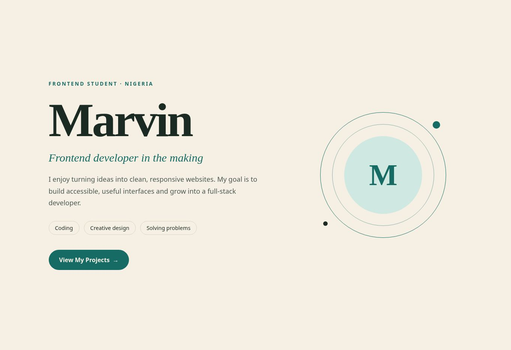

# Personal Intro Page — GoMyCode

Lovable project: https://lovable.dev/projects/dc87ef60-b2d6-4a5d-8c61-8c6d50e815af

1. Generated one hero section with Marvin's name, frontend subtitle, interests, goal, and a View My Projects link to GitHub.
2. Used the Lovable UI to request a deep teal color theme and smaller decorative M emblem.
3. Exported the self-contained public/intro.html source for local editing.
4. Manual improvement: increase description line-height from 1.5 to 1.75 for readability, with a CSS comment identifying the edit.

Open intro.html directly in a browser. It has inline styling and no external dependencies.

## Submission files

- [intro.html](intro.html): final standalone HTML export with manual spacing improvement.
- [intro-screenshot.jpg](intro-screenshot.jpg): browser screenshot of the final HTML page.

